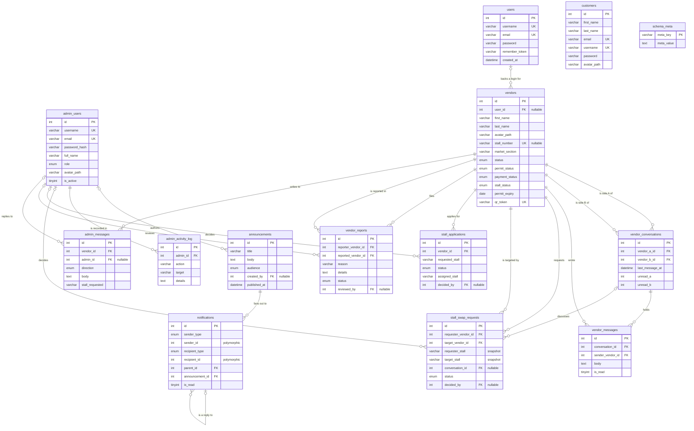

# MALLENGKE · Entity–Relationship Model

**Schema version 15** · InnoDB · `utf8mb4_unicode_ci` · 14 tables (13 domain + `schema_meta`) · 20 foreign keys
Source of truth: [`config/db.php`](../config/db.php) — the schema the app migrates itself toward.

Machine-readable twins of this document:

| File | Import into |
| --- | --- |
| [`schema.sql`](schema.sql) | MySQL / MariaDB, MySQL Workbench, DBeaver, dbForge Data Modeler |
| [`mallengke.dbml`](mallengke.dbml) | dbdiagram.io |

> **Why the DBML shows 1:N and not 0..1 on the parent side.**
> DBML has exactly four relationship operators — `-`, `<`, `>`, `<>` — and a
> parse error aborts the whole file, taking every relationship with it. So the
> DBML deliberately uses plain `>` for all 20 edges and carries the nullable-FK
> detail in the FK column's `note` instead. The seven `0..1` edges are listed in
> §3 and marked `(0..1)` beside their `Ref` line.

---

## 1. Diagram



---

## 2. Cardinality legend

| Notation | Meaning |
| --- | --- |
| `\|\|` | exactly one |
| `o\|` | zero or one |
| `o{` | zero or more |
| `\|{` | one or more |

Every relationship below is drawn from a **declared `FOREIGN KEY`**, not inferred from column naming.

---

## 3. Every relationship

`o|` on the parent side means the foreign-key column is `NULL` — the child row can exist with no parent at all.

### Identity

| Child | Column | Parent | Cardinality | On delete | Plain English |
| --- | --- | --- | --- | --- | --- |
| `vendors` | `user_id` | `users.id` | `o\|` 1 — `o{` 0..N | SET NULL | A login backs **zero or one** vendor row; a vendor has **zero or one** login. |
| `users` | — | — | 1 — 0..1 | — | Login is a leaf: it owns nothing. |

### Customers

Customers hold no foreign key and own no child rows — they are a leaf in the
relationship graph. (The customer↔vendor chat was retired in schema 14.)

### Vendors ↔ vendors

| Child | Column | Parent | Cardinality | On delete | Plain English |
| --- | --- | --- | --- | --- | --- |
| `vendor_conversations` | `vendor_a_id` | `vendors.id` | `\|\|` 1 — `o{` 0..N | CASCADE | A vendor is side **A** of zero or more vendor threads. |
| `vendor_conversations` | `vendor_b_id` | `vendors.id` | `\|\|` 1 — `o{` 0..N | CASCADE | A vendor is side **B** of zero or more vendor threads. |
| `vendor_messages` | `conversation_id` | `vendor_conversations.id` | `\|\|` 1 — `o{` 0..N | CASCADE | A vendor thread holds zero or more messages. |
| `vendor_messages` | `sender_vendor_id` | `vendors.id` | `\|\|` 1 — `o{` 0..N | CASCADE | A vendor writes zero or more messages. |

> **This is the many-to-many, resolved.** `vendors ↔ vendors`
> is conceptually M:N, but `UNIQUE (vendor_a_id, vendor_b_id)` on
> `vendor_conversations` means each *pair*
> gets exactly **one** thread — so the associative entity is 1:1 with the pair,
> and 1:N with each message.

### Announcements and notifications

| Child | Column | Parent | Cardinality | On delete | Plain English |
| --- | --- | --- | --- | --- | --- |
| `notifications` | `announcement_id` | `announcements.id` | `o\|` 1 — `o{` 0..N | CASCADE | An announcement fans out to **zero or more** inboxes; a notification is `NULL`-attached when it is not an announcement copy. |
| `notifications` | `parent_id` | `notifications.id` | `o\|` 1 — `o{` 0..N | CASCADE | A notification has **zero or more** replies (self-reference). |

### Office audit and decisions

| Child | Column | Parent | Cardinality | On delete | Plain English |
| --- | --- | --- | --- | --- | --- |
| `admin_activity_log` | `admin_id` | `admin_users.id` | `\|\|` 1 — `o{` 0..N | CASCADE | An admin accumulates zero or more log entries. |
| `announcements` | `created_by` | `admin_users.id` | `o\|` 1 — `o{` 0..N | SET NULL | An admin authors zero or more announcements. |
| `stall_swap_requests` | `decided_by` | `admin_users.id` | `o\|` 1 — `o{` 0..N | SET NULL | An admin decides zero or more swaps; an undecided swap has `NULL`. |
| `stall_applications` | `decided_by` | `admin_users.id` | `o\|` 1 — `o{` 0..N | SET NULL | An admin decides zero or more stall requests. |
| `vendor_reports` | `reviewed_by` | `admin_users.id` | `o\|` 1 — `o{` 0..N | SET NULL | An admin reviews zero or more reports. |
| `admin_messages` | `admin_id` | `admin_users.id` | `o\|` 1 — `o{` 0..N | SET NULL | A thread post is written by an admin or by the vendor side. |

All five nullable `admin_users` keys are `SET NULL` for the same reason: each row keeps a
`*_by_name` snapshot, so an announcement, a decision or a review must outlive the staff
account that made it.

### Stall swaps

| Child | Column | Parent | Cardinality | On delete | Plain English |
| --- | --- | --- | --- | --- | --- |
| `stall_swap_requests` | `requester_vendor_id` | `vendors.id` | `\|\|` 1 — `o{` 0..N | CASCADE | A vendor files zero or more swap requests. |
| `stall_swap_requests` | `target_vendor_id` | `vendors.id` | `\|\|` 1 — `o{` 0..N | CASCADE | A vendor is the counterparty in zero or more swap requests. |
| `stall_swap_requests` | `conversation_id` | `vendor_conversations.id` | `o\|` 1 — `o{` 0..N | SET NULL | A vendor thread can have zero or more swaps filed from it. |

`CHECK (requester_vendor_id <> target_vendor_id)` forbids the self-swap degenerate case.

### Stall applications

| Child | Column | Parent | Cardinality | On delete | Plain English |
| --- | --- | --- | --- | --- | --- |
| `stall_applications` | `vendor_id` | `vendors.id` | `\|\|` 1 — `o{` 0..N | CASCADE | A vendor files zero or more stall requests. |

### Vendor reports

| Child | Column | Parent | Cardinality | On delete | Plain English |
| --- | --- | --- | --- | --- | --- |
| `vendor_reports` | `reporter_vendor_id` | `vendors.id` | `\|\|` 1 — `o{` 0..N | CASCADE | A vendor files zero or more reports. |
| `vendor_reports` | `reported_vendor_id` | `vendors.id` | `\|\|` 1 — `o{` 0..N | CASCADE | A vendor is named in zero or more reports. |

### Vendor ↔ office thread

| Child | Column | Parent | Cardinality | On delete | Plain English |
| --- | --- | --- | --- | --- | --- |
| `admin_messages` | `vendor_id` | `vendors.id` | `\|\|` 1 — `o{` 0..N | CASCADE | A vendor has a thread with the office holding zero or more posts. |

---

## 4. One-to-one relationships

There is **no** `UNIQUE` foreign key in the schema, so no relationship is physically 1:1.
Four places encode a 1:1 intent anyway:

| Where | Constraint | Intent |
| --- | --- | --- |
| `users.id` → `vendors.user_id` | `idx_vendors_user` (plain `KEY`) | One login should back **at most one** vendor record. |
| `customers.email`, `customers.username` | `UNIQUE` | One account identity, one shopper row. |
| `admin_users.username`, `admin_users.email` | `UNIQUE` | One staff identity, one admin row. |
| `vendors.qr_token`, `vendors.stall_number` | `UNIQUE` | One vendor per QR pass; **one vendor per stall**. |

`UNIQUE (stall_number)` is the model's most important business 1:1: a stall can be held by
at most one vendor. `stall_number` is nullable so a vendor awaiting assignment can have none.

---

## 5. Declared vs intended

Read-only notes. Nothing here is changed by the exported files — they describe reality.

### 5.1 Columns that look like foreign keys and are not

| Table | Column | Looks like it should be | Actually is |
| --- | --- | --- | --- |
| `notifications` | `sender_id` / `recipient_id` | `FK` | **intentionally polymorphic** — the `*_type` column names the target table, so no single FK is possible. |

Everything else that referenced an id is now a real constraint. The two that
used to float free — `announcements.created_by` and `stall_applications.decided_by`
— were closed in schema version 13; both columns already carried a valid
`admin_users.id` on every live row, so the keys applied with no data fix.

### 5.2 `vendors.user_id` is 1:N, intent is 1:1

`idx_vendors_user` is a plain `KEY`, so nothing stops one login backing several
vendor rows. This was reviewed and left as-is: tightening it to `UNIQUE` would
make the relationship real, but it is a product decision about whether a login
may ever stand in for more than one stallholder, not a data defect.

For reference, the change would be one line in `config/db.php`:

```php
'uniq_vendors_user' => '!user_id',   // was: 'idx_vendors_user' => 'user_id',
```

Check for duplicates first (`SELECT user_id, COUNT(*) c FROM vendors WHERE user_id IS NOT NULL GROUP BY user_id HAVING c > 1;`).
It currently returns nothing, so the key would apply cleanly.

### 5.3 Polymorphic columns

`notifications.sender_id` and `notifications.recipient_id` resolve at read time against
whichever table `sender_type` / `recipient_type` names. A modeler will draw them as
free-standing integers; that is correct, not a bug. The same applies to
`admin_messages.direction` (`ENUM 'vendor'|'admin'`) —
it encodes "which side of the thread" without needing a second FK.

### 5.4 Snapshotted columns

`stall_swap_requests.requester_stall`, `.requester_section`, `.target_stall`,
`.target_section` and `admin_messages.stall_requested` deliberately duplicate
`vendors.stall_number` / `vendors.market_section` as of the moment of the event, so the
row stays a faithful audit record after the vendors trade stalls. They are **not**
foreign keys and must not be drawn as such.

---

## 6. Referential integrity at a glance

| Rule | Applied to |
| --- | --- |
| `ON DELETE CASCADE` | Ownership rows die with their parent: vendor_messages, vendor_conversations, notifications (incl. reply children), admin_activity_log, stall_swap_requests, stall_applications, vendor_reports, admin_messages. |
| `ON DELETE SET NULL` | Bookkeeping that must survive: `vendors.user_id`, `announcements.created_by`, `stall_swap_requests.conversation_id`, `stall_swap_requests.decided_by`, `stall_applications.decided_by`, `vendor_reports.reviewed_by`, `admin_messages.admin_id`. |
| `ON UPDATE CASCADE` | Every one of the 20 FKs. |
| `CHECK` constraints | `chk_vendors_stall`, `chk_vendors_section`, `chk_vm_body`, `chk_vc_order`, `chk_notif_title`, `chk_ann_title`, `chk_swap_distinct`, `chk_swap_decided`, `chk_sa_decided`, `chk_sa_assigned`, `chk_vr_distinct`, `chk_vr_details`, `chk_am_body`. |

Two `CHECK`s are what make composite `UNIQUE` keys meaningful:
`chk_vc_order (vendor_a_id < vendor_b_id)` canonicalises the vendor pair so
`uniq_vc_pair` is a real uniqueness guarantee no matter who opened the chat.

### 6.1 Every FK is served by an index

A foreign key with no usable index turns every parent delete or id update into a
full scan of the child. So each child column below is the **leading** column of at
least one index — which is also why the migration treats a foreign-key-backed
index as undroppable rather than collapsing it as a duplicate.

| Child column | Index that serves it | Shared with a lookup? |
| --- | --- | --- |
| `vendors.user_id` | `idx_vendors_user` | — |
| `vendor_conversations.vendor_a_id` / `.vendor_b_id` | `idx_vc_a` / `idx_vc_b` | conversation lists, newest first |
| `vendor_messages.conversation_id` | `idx_vm_conv` | thread scrollback |
| `vendor_messages.sender_vendor_id` | `fk_vm_sender` | — |
| `notifications.parent_id` | `idx_notif_parent` | reply threading |
| `notifications.announcement_id` | `idx_notif_announcement` | read-count rollups |
| `admin_activity_log.admin_id` | `idx_log_admin` | one admin's audit trail |
| `announcements.created_by` | `idx_ann_author` | — |
| `stall_swap_requests.requester_vendor_id` | `idx_swap_req` | "my requests", newest first |
| `stall_swap_requests.target_vendor_id` | `idx_swap_tgt` | "requests aimed at me" |
| `stall_swap_requests.conversation_id` | `fk_swap_conv` | — |
| `stall_swap_requests.decided_by` | `fk_swap_admin` | — |
| `stall_applications.vendor_id` | `idx_sa_vendor` | **`(vendor_id, status)`** — see below |
| `stall_applications.decided_by` | `idx_sa_decider` | — |
| `vendor_reports.reporter_vendor_id` / `.reported_vendor_id` | `idx_vr_reporter` / `idx_vr_reported` | per-vendor report queues |
| `vendor_reports.reviewed_by` | `fk_vr_reviewer` | — |
| `admin_messages.vendor_id` | `idx_am_vendor` | a vendor's office thread |
| `admin_messages.admin_id` | `fk_am_admin` | — |

`stall_applications.idx_sa_vendor` is the one place the coupling is load-bearing.
It is declared `(vendor_id, status)` rather than a bare `(vendor_id)`, because
`vendor_id` is both the foreign key and the first filter of "this vendor's
requests" — which `config/stalls.php` asks for as `WHERE vendor_id = ? AND
status = 'Pending'` in three places. One composite satisfies the key *and* the
query, where two structures would mean two writes to maintain per row.

Narrowing it is not free, and MySQL will not simply let it happen: an index a
foreign key depends on cannot be dropped while the key exists, and the name is
then unavailable for the replacement. `mk_reindex_fk_backed()` in `config/db.php`
handles that explicitly — lift the key off, drop, restore wider, re-attach.

### 6.2 The migration reconciles, it does not just check

Two failure modes here are silent, and both have bitten this schema before:

**A foreign key is not the same thing as a constraint name.** A key left over
from an older release can sit on the wrong column or carry a narrower
`ON UPDATE` rule, and a check that only asks "does `fk_vm_conv` exist?" reports
success forever. Four keys were sitting on `ON UPDATE RESTRICT` while the design
said `CASCADE`. `mk_fk()` now compares the child column, the referenced table
and column, and both referential actions, and rebuilds the key when any of them
differ.

**`INDEX_NAME` does not exist on `KEY_COLUMN_USAGE` in MariaDB.** It is a MySQL
column; MariaDB only has it on `STATISTICS`. Querying it in the wrong place
throws, and a helper that swallows the exception and returns `[]` looks exactly
like "there are no foreign-key-backed indexes here". That is how
`stall_applications.idx_sa_vendor` stayed stuck at `(vendor_id)` while the design
called for `(vendor_id, status)` — the migration tried to drop a foreign-key
index, was refused, and then tried to reuse the name, and reported two warnings
nobody read. Both helpers now derive the index from `STATISTICS`, which behaves
identically on MySQL and MariaDB.

The migration is idempotent and re-runnable, and a clean run reports
`warnings=0`.

---

## 7. Tables with no relationships

| Table | Role |
| --- | --- |
| `customers` | Holds no foreign key and owns no child rows. A leaf in the relationship graph. |
| `users` | Outgoing edge only: `vendors`. |
| `schema_meta` | Internal bookkeeping (schema version + last migration report). Domain-irrelevant. |
